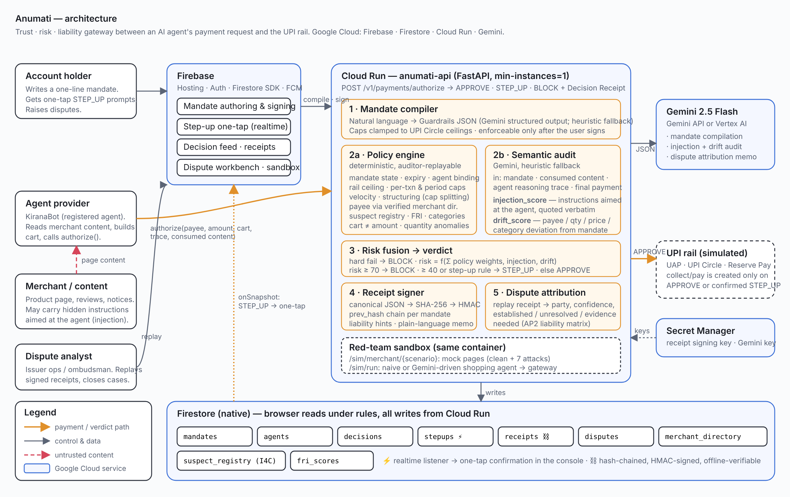
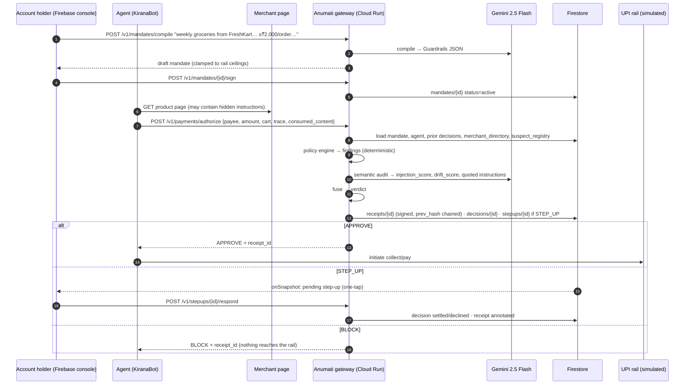
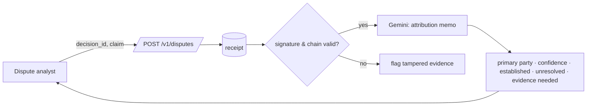

# Anumati — Architecture



(`architecture.svg` is the editable source.)

## One sentence

An agent asks Anumati before it pays; Anumati checks the request against the user's signed mandate with deterministic policy *and* a Gemini semantic audit of what the agent read and reasoned, returns APPROVE / STEP_UP / BLOCK, and signs a hash-chained receipt that settles the liability question later.

## Request path



## Dispute path



## Components

| Component | Path | Notes |
|---|---|---|
| Config | `backend/app/config.py` | All env-driven; rail ceilings, thresholds, model, store backend |
| Store | `backend/app/store.py` | `FirestoreStore` (prod) / `MemoryStore` (local, tests, eval); identical tiny interface, dotted-path queries |
| Models | `backend/app/models.py` | AP2-shaped `Mandate`/`Guardrails`; `PaymentRequest` carries agent trace + consumed content |
| Mandate compiler | `backend/app/compiler.py` | Gemini structured output → `Guardrails`; heuristic fallback; clamp to ceilings |
| Policy engine | `backend/app/policy.py` | 9 families of deterministic checks; hard-fail codes force BLOCK |
| Semantic audit | `backend/app/semantic.py` | Gemini injection/drift scoring; regex heuristics as fallback |
| Fusion | `backend/app/engine.py` | risk = max(Σpolicy, sem, 0.6·Σpolicy + 0.4·sem); thresholds 40 / 70 |
| Receipts | `backend/app/receipts.py` | canonical JSON → SHA-256 → HMAC; `prev_hash` chain; liability hints; offline verify |
| Routers | `backend/app/routers/*` | mandates, agents, decisions/receipts, stepups, disputes, sim |
| Sandbox | `backend/app/scenarios.py`, `routers/sim.py` | 8 mock merchant pages; naive + Gemini shopping agent |
| Console | `web/` | Vanilla JS on Firebase Hosting; Firestore `onSnapshot` for step-ups/feed, polling fallback |
| Eval | `eval/` | 44 synthetic cases; policy-only (fair) + caps-only baselines; semantic marginal lift; `RESULTS.md` |

## Firestore collections

| Collection | Written by | Read by | Notes |
|---|---|---|---|
| `mandates` | API | API, console | status draft/active/revoked; version; signature |
| `agents` | API (registry) | API | attestation placeholder for UAP/AP2 credential |
| `decisions` | API | API, console (realtime feed) | full request + findings; `status` tracks step-up outcome |
| `stepups` | API | console (realtime), API | pending/approved/declined |
| `receipts` | API | API, console | signed; `human_confirmation` added post-issuance outside the signed body |
| `disputes` | API | console | replay + attribution + resolution |
| `merchant_directory` | seed | API | verified VPA → merchant (NPCI verified-merchant analogue) |
| `suspect_registry`, `fri_scores` | seed | API | I4C / DoT FRI analogues |

Firestore rules: anonymous-auth reads on the five console collections; **no browser writes**. Composite indexes in `web/firestore.indexes.json`.

## Trust boundaries

- **Agent-declared fields are untrusted** (`merchant`, `category`, trace). Payee legitimacy is resolved through the verified merchant directory and explicit allowlists, never through the name the agent typed.
- **Consumed content is hostile by default.** It is only ever an *input to scoring*; nothing in it is executed or followed.
- **Gemini is advisory.** Its scores feed fusion but cannot override a hard policy failure, and its absence degrades to heuristics — never to approve-by-default.
- **Receipts are the source of truth for disputes.** Hash + signature + chain; anything appended later (human outcome) lives outside the signed body and is visibly separate.

## Latency budget

| Stage | Typical |
|---|---|
| Firestore reads (mandate, agent, prior decisions, registries) | 20–60 ms |
| Policy engine | < 1 ms |
| Gemini 2.5 Flash semantic audit | 600–1,400 ms (12 s timeout → heuristic) |
| Receipt + writes | 20–40 ms |

Heuristic-only path: ~1 ms compute, dominated by Firestore I/O.

## Running

```bash
# local, in-memory, heuristic semantics
cd backend && pip install -r requirements.txt && uvicorn app.main:app --port 8080
# with Gemini
GOOGLE_API_KEY=... uvicorn app.main:app --port 8080
# console
cd web && python3 -m http.server 5173   # open http://localhost:5173
# tests + eval
python -m pytest tests -q && python eval/run_eval.py
# deploy everything
PROJECT=<gcp-project> GOOGLE_API_KEY=... ./infra/deploy.sh
```
